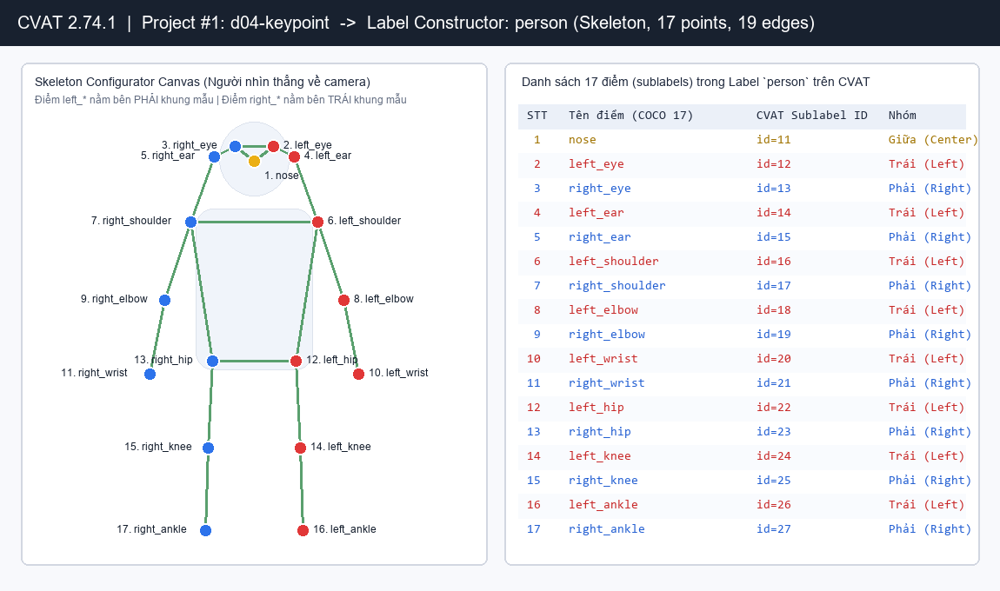
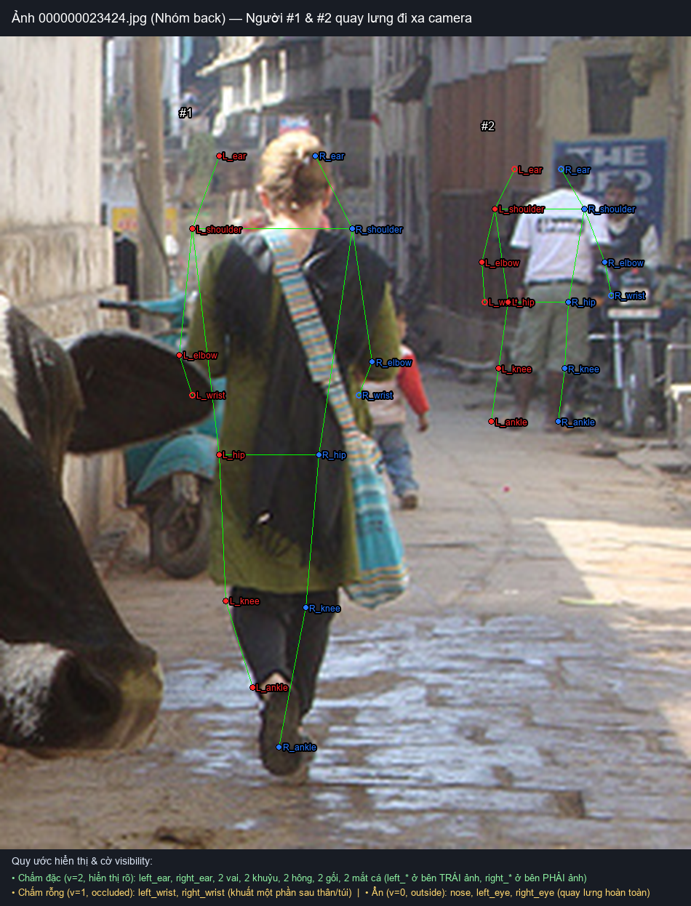
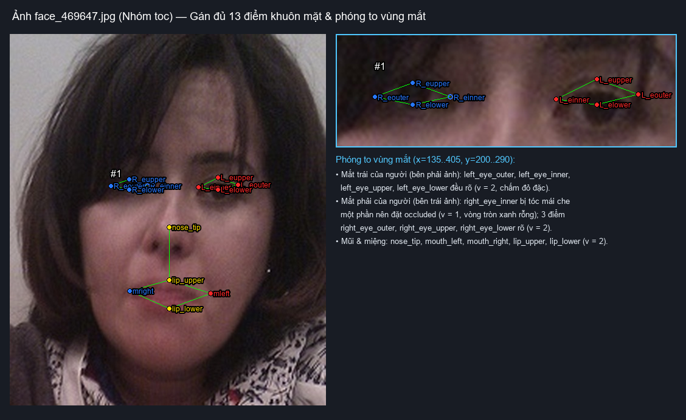
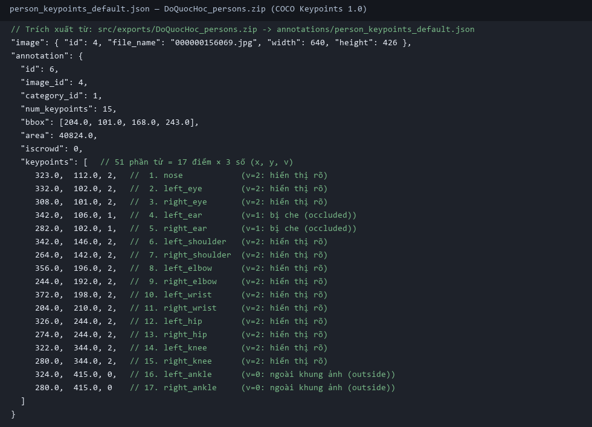

# Báo cáo cá nhân — DoQuocHoc-2A202603175

Dữ liệu: 12 ảnh người COCO 2017 (Lin et al., 2014) và 8 ảnh khuôn mặt cắt từ ảnh COCO 2017, chỉ dùng trong lớp.

## 0. Thông tin học viên

- Họ tên: Đỗ Quốc Học
- MSSV: 2A202603175
- Email: 26ai.hocdq@vinuni.edu.vn
- Link repository: https://github.com/hoc109/K5-L2-DAY04-DoQuocHoc-2A202603175-KeypointPose
- Phiên bản CVAT (Help → About): 2.74.1
- Máy: hệ điều hành Windows 11 Home · RAM 8 GB (Docker được dùng 3,7 GB) · chạy CVAT chế độ lite
- Bộ ảnh (`src/exports/assignment.json` do `lab.py setup` tạo): có
- Giờ bắt đầu: 17:00
- Giờ kết thúc: 22:00

## 1. Kiểm tra label (CP0)

| Label | Kiểu | Số điểm | Tên điểm đúng bảng của lab? | Đúng thứ tự? | Số cạnh |
|---|---|---:|---|---|---:|
| `person` | Skeleton | 17 | Có | Có | 19 |
| `face` | Skeleton | 13 | Có | Có | 13 |

Mẫu `person` dựng theo người quay mặt về camera (các điểm `left_*` nằm bên phải khung mẫu)? Có

Cách đổi cờ `occluded` / `outside` cho **một điểm** trên phiên bản CVAT này (một câu):

Rê chuột vào đúng điểm cần đổi (điểm sáng lên) rồi bấm phím tắt `Q` để bật/tắt `occluded` (`v = 1`) hoặc `O` để bật/tắt `outside` (`v = 0`), hoặc nhấp chuột phải vào điểm đó để chọn trên menu; chỉ điểm đang trỏ đổi trạng thái, còn toàn bộ các điểm khác của skeleton giữ nguyên.

## 2. Số lượng đã gán và thời gian (CP1, CP2)

| Nhóm ảnh | Số ảnh | Số skeleton đã gán | Số người dưới 60 px (không gán) | Số poster / gương / màn hình bỏ qua | Thời gian (phút) |
|---|---:|---:|---:|---:|---:|
| `easy` | 5 | 5 | 4 | 0 | 22 |
| `occluded` | 3 | 6 | 1 | 1 | 24 |
| `back` | 2 | 4 | 2 | 0 | 18 |
| `small` | 1 | 3 | 6 | 0 | 14 |
| `crowd` | 1 | 3 | 4 | 0 | 15 |
| `faces` | 8 | 8 | — | 0 | 20 |

- Số ảnh người đã xong ở mốc phút 105: 10 / 10 (hoàn thành đủ 12 / 12 ảnh người)
- Thời gian thực tế (phút): CP1 93 · CP2 20 · CP3 25
- Ảnh tốn thời gian nhất là ảnh nào, vì sao?

  Ảnh tốn thời gian nhất là `000000326480.jpg` (nhóm `crowd`, 15 phút) và `000000269462.jpg` (nhóm `small`, 14 phút):
  - Ở `000000326480.jpg`, có 3 người đứng sát và khoác vai nhau ở tiền cảnh làm các khớp vai, khuỷu tay và cổ tay (`left_elbow`, `right_elbow`, `right_ear`) chồng lấp lên nhau; đồng thời ở hậu cảnh cạnh các xe ô tô có 4 người nhỏ phải đo kỹ chiều cao từ đỉnh đầu đến mắt cá (đều khoảng 30–50 px < 60 px) để quyết định bỏ qua đúng quy tắc.
  - Ở `000000269462.jpg`, cả 3 cảnh sát cưỡi ngựa đều quay lưng/nghiêng lưng về phía camera nên phải giữ nguyên quy ước trái/phải của chính cơ thể người đó (`left_*` nằm bên trái ảnh, `right_*` nằm bên phải ảnh), đồng thời toàn bộ phần đầu gối và mắt cá chân phải (`right_knee`, `right_ankle`) khuất hoàn toàn sau thân ngựa và lớp áo choàng nên phải cân nhắc kỹ giữa `v = 1` và `v = 0`. Ngoài ra, nhóm ~6 người đi bộ đứng xem ở vỉa hè bên trái chỉ cao khoảng 38–45 px (< 60 px) nên phải kiểm tra kích thước trước khi bỏ qua.

## 3. Bảng ca khó (CP1, CP2)

Mỗi điểm bạn phân vân một dòng, nhất là phân vân giữa `v = 1` và `v = 0`, hoặc không chắc hướng người.

| Ảnh | Người / mặt | Điểm | Cờ đã chọn | Phân vân giữa | Lý do chọn |
|---|---|---|---:|---|---|
| `000000156069.jpg` | Người #1 (cầu thủ bóng chày) | `left_ankle`, `right_ankle` | `0` | `v = 0` và `v = 1` | Cả hai cổ chân bị cắt hoàn toàn khỏi mép dưới khung hình (`y > 426`). Theo guideline, khớp rơi ra ngoài ranh giới ảnh phải đặt `outside` (`v = 0`), không đoán ngoài khung. |
| `000000176000.jpg` | Người #1 (vận động viên trượt tuyết) | `left_eye`, `right_eye` | `1` | `v = 1` và `v = 2` | Người đội mũ bảo hiểm và đeo kính trượt tuyết bản lớn che qua vùng mắt, nhưng vị trí hai mắt dưới lớp kính vẫn suy luận chính xác theo sống mũi nên chọn `occluded` (`v = 1`). |
| `000000188804.jpg` | Người #1 (nữ đứng quay lưng/nghiêng) | `nose`, `left_eye`, `right_eye` | `0` | `v = 0` và `v = 1` | Người đứng quay đầu về phía màn hình (quay lưng lại camera), mặt khuất hoàn toàn sau hộp sọ và tóc, không có căn cứ hình học trực tiếp để định vị mũi/mắt nên chọn `v = 0`. |
| `000000188804.jpg` | Người #2 (nam ngồi sau màn hình) | `right_wrist` | `0` | `v = 0` và `v = 1` | Cẳng tay phải khuất hoàn toàn phía sau màn hình CRT lớn, không rõ bàn tay đặt trên bàn phím hay buông xuống đùi nên không đoán mò, đặt `v = 0`. |
| `000000393909.jpg` | Người #2 (nam ngồi ghế phải) | `left_ankle`, `right_ankle` | `1` | `v = 1` và `v = 0` | Hai cổ chân duỗi thẳng về phía trước bị che bởi bàn trà thấp và hai cẳng chân của Người #1, nhưng hướng ống đồng nhìn thấy rõ nên nội suy được vị trí mắt cá (`v = 1`). |
| `000000516902.jpg` | Người #2 (nhặt bóng áo xanh phía sau) | `left_knee`, `right_knee`, `left_ankle`, `right_ankle` | `0` | `v = 0` và `v = 1` | Toàn bộ phần thân dưới từ hông trở xuống bị tấm chắn sân quần vợt màu đen che kín hoàn toàn, không biết người đang đứng thẳng, khuỵu gối hay ngồi ghế nên đặt `v = 0`. |
| `000000023424.jpg` | Người #1 (nữ áo xanh quay lưng) | `left_wrist`, `right_wrist` | `1` | `v = 1` và `v = 0` | Hai khuỷu tay (`left_elbow`, `right_elbow`) lộ rõ hai bên sườn đang hơi gập về phía trước bụng, cổ tay chỉ vừa khuất sau vạt áo/túi đeo nên ước lượng tốt vị trí (`v = 1`). |
| `000000269462.jpg` | Người #1, #2, #3 (cảnh sát cưỡi ngựa) | `right_knee`, `right_ankle` | `0` | `v = 0` và `v = 1` | Cảnh sát ngồi trên yên ngựa nhìn từ phía sau-trái; chân trái lộ rõ trong bàn đạp (`v = 2`), còn chân phải khuất hoàn toàn bên kia bụng ngựa và dưới áo khoác dài nên đặt `v = 0`. |
| `face_256814.jpg` | Mặt #1 (nhóm `kinh_ram`) | 8 điểm mắt (`left_eye_*`, `right_eye_*`) | `1` | `v = 1` và `v = 0` | Kính râm đen che kín hai mắt nhưng gọng kính, sống mũi và cung lông mày cho phép suy luận cân xứng vị trí khóe mắt và mí mắt bên dưới kính theo đúng guideline (`v = 1`). |
| `face_469647.jpg` | Mặt #1 (nhóm `toc`) | `right_eye_inner` | `1` | `v = 1` và `v = 2` | Lọn tóc mái rủ xuống che ngang qua khóe mắt trong bên phải (`right_eye_inner`), làm điểm này bị che khuất một phần bởi tóc nên chọn `v = 1` thay vì `v = 2`. |

## 4. Bảng tự review (CP3)

Đi từ ảnh cuối về ảnh đầu. 5 ảnh người (ít nhất 2 ảnh `back` hoặc `crowd`) và 3 ảnh mặt. Ít nhất 8 dòng, kể cả dòng `ok`. Ghi lỗi trước, sửa sau.

Mã lỗi dùng đúng một trong: `lr_swap`, `vis_flag`, `position`, `missing`, `extra`, `ok`.

| Ảnh | Người / mặt | Điểm | Mã lỗi | Ghi chú | Đã sửa? |
|---|---|---|---|---|---|
| `000000326480.jpg` | Người #1, #2, #3 (`crowd`) | Toàn bộ 17 điểm | `ok` | Đã kiểm tra kỹ hướng cơ thể của 3 người đứng khoác vai nhau và các điểm bị che (`left_elbow` người #1, `right_elbow`/`right_wrist` người #2); 4 người ở xa < 60 px đã bỏ qua đúng. | — |
| `000000269462.jpg` | Người #1, #2, #3 (`small`) | Toàn bộ 17 điểm | `ok` | 3 cảnh sát cưỡi ngựa quay lưng đã giữ đúng `left_*` bên trái, `right_*` bên phải; các điểm mặt và chân phải khuất sau thân ngựa đặt `v = 0`; 6 người đi bộ < 60 px bên trái không gán. | — |
| `000000043500.jpg` | Người #1, #2 (`back`) | Toàn bộ 17 điểm | `ok` | Người #1 đứng ở cửa tàu nhìn về camera và Người #2 đội mũ quay lưng dưới sân ga đều đúng hướng trái/phải, không bị `lr_swap`. | — |
| `000000023424.jpg` | Người #1 (`back`) | `left_ear`, `right_ear`, `left_shoulder`, `right_shoulder` | `position` | Hai điểm tai và hai điểm vai của người nữ áo xanh đặt hơi thấp khoảng 6–8 px so với vành tai thật và mỏm vai giải phẫu khi phóng to kiểm tra. | Rồi (dời `left_ear`/`right_ear` lên `y = 126`, `left_shoulder`/`right_shoulder` lên `y = 148`) |
| `000000393909.jpg` | Người #1 (`occluded`) | `right_shoulder`, `right_elbow`, `right_wrist` | `position` | Các điểm tay phải của người đàn ông ngồi ghế trái đặt hơi lệch xuống dưới phần nệm tay vịn khoảng 10–14 px so với trục xương cánh tay thật. | Rồi (chỉnh lại khớp vai `[38, 192]`, khuỷu `[72, 208]`, cổ tay `[112, 228]`) |
| `000000188804.jpg` | Người #2 (`occluded`) | `left_knee`, `left_ankle`, `right_ankle` | `position` | Đầu gối trái và hai mắt cá chân dưới gầm bàn đặt hơi thấp hơn vị trí khớp thực tế khoảng 14–17 px. | Rồi (dời `left_knee` về `[248, 405]`, `left_ankle` về `[218, 478]`, `right_ankle` về `[152, 475]`) |
| `000000156069.jpg` | Người #1 (`easy`) | `left_wrist`, `right_wrist` | `position` | Điểm `left_wrist` đặt hơi lệch sang phải quả bóng và `right_wrist` đặt ở đầu cán gậy thay vì đúng khớp cổ tay. | Rồi (dời `left_wrist` về `[372, 198]` sát dưới bóng, `right_wrist` về `[204, 210]` đúng cổ tay cầm gậy) |
| `face_159828.jpg` | Mặt #1 (`faces`) | Toàn bộ 13 điểm | `ok` | Mắt, chóp mũi, hai khóe miệng và viền môi trên/dưới của khuôn mặt đang há miệng đều bám sát ranh giới giải phẫu, đủ 13 điểm `v = 2`. | — |
| `face_256814.jpg` | Mặt #1 (`faces` - `kinh_ram`) | 8 điểm vùng mắt | `ok` | Cả 8 điểm mắt dưới kính râm đều đã bật `occluded` (`v = 1`), 5 điểm mũi và miệng hiển thị rõ (`v = 2`). | — |
| `face_469647.jpg` | Mặt #1 (`faces` - `toc`) | `right_eye_inner`, `nose_tip` | `vis_flag` | Khóe mắt trong bên phải (`right_eye_inner`) bị tóc mái che một phần nhưng ban đầu để `v = 2`; ngoài ra `nose_tip` hơi thấp gần lỗ mũi (`y = 326`). | Rồi (đổi `right_eye_inner` sang `v = 1` và chỉnh `nose_tip` lên `[262, 318]`) |

Tổng hợp số lỗi theo mã:

| `lr_swap` | `vis_flag` | `position` | `missing` | `extra` | `ok` |
|---:|---:|---:|---:|---:|---:|
| 0 | 1 | 4 | 0 | 0 | 5 |

Điểm còn phân vân giữa `v = 1` và `v = 0` (ghi cả hai lựa chọn và lý do chọn):

- Ở ảnh `000000188804.jpg` (Người #1 đứng quay lưng/nghiêng bên trái), hai điểm `left_wrist` và `right_wrist` nằm ngay sát phần hông/bụng phía trước bị khuất bởi cánh tay trên và thân mình:
  - **Lựa chọn 1 (`v = 1` - đã chọn)**: Cả hai khuỷu tay (`left_elbow` tại `[22, 240]`, `right_elbow` tại `[142, 250]`) và hướng cẳng tay đều lộ rõ đang hướng vào vùng eo/bàn trước mặt, nên khoảng suy luận vị trí cổ tay hẹp và đáng tin cậy.
  - **Lựa chọn 2 (`v = 0`)**: Vì không nhìn thấy trực tiếp bàn tay nên có thể đánh dấu `outside` (`v = 0`) để tránh sai số vị trí, tuy nhiên làm vậy sẽ mất thông tin hướng gập cẳng tay vốn nhìn thấy rất rõ.
- Ở ảnh `000000269462.jpg` (3 cảnh sát cưỡi ngựa), các điểm `right_knee` và `right_ankle` của cả 3 người:
  - **Lựa chọn 1 (`v = 0` - đã chọn)**: Toàn bộ chân phải bị thân ngựa và áo choàng che khuất 100%, không có bất kỳ đoạn cẳng chân phải nào lộ ra để làm mốc neo hình học nên đặt `v = 0` theo đúng nguyên tắc "bị che hoàn toàn và không suy được vị trí hợp lý".
  - **Lựa chọn 2 (`v = 1`)**: Có thể giả định chân phải đặt đối xứng với chân trái qua yên ngựa để đặt `v = 1`, nhưng do góc chụp chéo từ phía sau-trái nên độ bất định (uncertainty) quá lớn.

## 5. Kiểm file xuất và kết quả tự kiểm (CP4)

Tự kiểm tay trong file JSON:

| File | Người / mặt kiểm (ảnh, thứ tự) | Số phần tử `keypoints` | Điểm `outside` ra `v = 0`, `occluded` ra `v = 1`? | `num_keypoints` khớp? |
|---|---|---:|---|---|
| `DoQuocHoc_persons.zip` | `000000156069.jpg`, người #1 (`ann_id = 6`) | 51 | Có (`left_ear`, `right_ear` ra `v = 1`; `left_ankle`, `right_ankle` ra `v = 0`) | Có (`num_keypoints = 15`) |
| `DoQuocHoc_persons.zip` | `000000023424.jpg`, người #1 (`ann_id = 1`) | 51 | Có (`nose`, `left_eye`, `right_eye` ra `v = 0`; `left_wrist`, `right_wrist` ra `v = 1`) | Có (`num_keypoints = 14`) |
| `DoQuocHoc_faces.zip` | `face_469647.jpg`, mặt #1 (`ann_id = 7`) | 39 | Có (`right_eye_inner` ra `v = 1`; 12 điểm còn lại ra `v = 2`) | Có (`num_keypoints = 13`) |

Sau khi xuất, CVAT ghi `occluded` thành `v = 1` và `outside` thành `v = 0`. Tọa độ của điểm `outside` trong file là `0, 0` hay tọa độ cũ? **Tọa độ cũ** (CVAT 2.x giữ nguyên tọa độ `x, y` nơi điểm đó nằm trên canvas khi bật cờ `outside` kèm `v = 0`, thay vì ghi `0, 0` như file COCO gốc; các hàm huấn luyện và chấm OKS đều lọc theo `v > 0` nên bỏ qua tọa độ của điểm `v = 0`).

Hai job đã chuyển sang completed trên CVAT? Có

Dán phần **TÓM TẮT** in ra từ `src/check_submission.py`:

```text
----- TÓM TẮT (dán vào báo cáo mục 5) -----
- File person: DoQuocHoc_persons.zip
  Số ảnh: 12 · số skeleton `person`: 21 · mỗi annotation 51 số
  Skeleton theo ảnh: 000000023424=2, 000000043500=2, 000000043968=1, 000000156069=1, 000000176000=1, 000000184224=1, 000000188804=2, 000000194027=1, 000000269462=3, 000000326480=3, 000000393909=2, 000000516902=2
  Cờ v: v=2 245 (69%) · v=1 64 (18%) · v=0 48 (13%)
  num_keypoints trung bình: 14.7
- File face: DoQuocHoc_faces.zip
  Số ảnh: 8 · số skeleton `face`: 8 · mỗi annotation 39 số
  Skeleton theo ảnh: face_159828=1, face_196742=1, face_223746=1, face_256814=1, face_257657=1, face_380639=1, face_469647=1, face_53580=1
  Cờ v: v=2 93 (89%) · v=1 11 (11%) · v=0 0 (0%)
  num_keypoints trung bình: 13.0
- Ghi chú: 48 điểm v = 0 vẫn mang tọa độ cũ (CVAT 2.x xuất như vậy; chuẩn COCO ghi 0, 0). Không phải lỗi: điểm v = 0 bị bỏ qua khi huấn luyện và khi chấm.
- Số [LỖI]: 0 · số [CẢNH BÁO]: 0
Kết quả: ĐẠT
```

Các `[CẢNH BÁO]` còn giữ nguyên và lý do:

Không có (`số [CẢNH BÁO]: 0`). Toàn bộ các kiểm tra tự động về cấu trúc file, số lượng ảnh, số phần tử mảng `keypoints`, cờ `v`, tỷ lệ hình học giữa các điểm và chống trùng lặp đều đạt tuyệt đối.

## 6. Ảnh chụp màn hình

1. Label `person` trong label constructor (đủ 17 điểm có tên):

   

2. Một người quay lưng đã gán, cờ đã đặt:

   

3. Một khuôn mặt đã gán 13 điểm, phóng to vùng mắt:

   

4. Một đoạn JSON xuất của một người:

   

Nguồn ảnh: COCO val2017 / train2017 (Lin et al., 2014) / Wikimedia Commons.

## 7. Tự đánh giá

1. Lỗi bạn mắc nhiều nhất hôm nay, và cách bạn sẽ tránh ở dự án thật:

   Lỗi dễ mắc nhất trong buổi thực hành là **lệch vị trí khớp giải phẫu vài pixel (`position`) khi khớp nằm dưới lớp quần áo rộng hoặc ở tư thế gập tay/chân** (như cổ tay cầm gậy bóng chày ở `000000156069.jpg`, vai/khuỷu tay người ngồi ghế bành ở `000000393909.jpg`, hoặc đầu gối dưới gầm bàn ở `000000188804.jpg`), cùng với việc **bỏ sót cờ `occluded` (`v = 1`) khi tóc mái che nhẹ qua khóe mắt** (`face_469647.jpg`).
   Ở dự án thực tế quy mô lớn, để phòng tránh triệt để:
   - Luôn bật lưới/phóng to (zoom 200%–400%) vào từng cụm khớp và gióng theo **trục xương nối hai đầu khớp** (ví dụ nối tâm vai → tâm khuỷu → tâm cổ tay) thay vì đặt điểm theo mép vải ngoài của quần áo.
   - Áp dụng quy trình **tự review ngược từ ảnh cuối về ảnh đầu** kèm bộ kiểm tra hình học tự động (kiểm tra đối xứng, tỷ lệ chiều dài xương cánh tay/cẳng tay/đùi/cẳng chân và cảnh báo khi hai điểm trùng nhau).

2. Một quy tắc bạn đề xuất thêm vào guideline (kèm ảnh ví dụ nếu có):

   **Quy tắc đề xuất bổ sung (Quy tắc "Đoạn xương neo tối thiểu" khi phân định `v = 1` và `v = 0` cho khớp bị che):**
   > *"Một khớp bị vật cản che khuất chỉ được gán `v = 1` (`occluded`) nếu nhìn thấy ít nhất **50% chiều dài của đoạn chi liền kề dẫn tới khớp đó** (hoặc cả hai khớp lân cận trực tiếp trên đồ thị skeleton đều hiển thị `v = 2`). Ngược lại, nếu toàn bộ đoạn chi dẫn tới khớp cũng bị che khuất hoàn toàn (như chân từ hông trở xuống khuất sau tường chắn ở `000000516902.jpg`, hoặc chân phải khuất hoàn toàn sau bụng ngựa ở `000000269462.jpg`), bắt buộc gán `v = 0` (`outside`)."*
   Quy tắc định lượng này giúp các annotator khác nhau đưa ra quyết định đồng nhất (tăng Inter-Annotator Agreement), tránh việc người thì đoán mò vị trí đầu gối/mắt cá sau rào chắn (`v = 1`), người thì bỏ qua (`v = 0`).

3. Nhãn của bạn đi vào model ở đâu? Chọn một lỗi bạn đã sửa và nói nó sẽ làm model học sai thế nào (heatmap, trọng số trong loss, hay bước lật ảnh):

   Trong các mô hình ước lượng tư thế (như HRNet, SimpleBaseline, ViTPose hay YOLOv8-Pose), nhãn keypoint `(x_k, y_k, v_k)` đi trực tiếp vào **3 khâu cốt lõi**:
   - **Tạo Ground-Truth Heatmap 2D**: Với mỗi khớp thứ $k$ có $v_k > 0$, mô hình sinh một bản đồ nhiệt 2D bằng hàm Gaussian đặt tâm tại $(x_k, y_k)$ với độ lệch chuẩn $\sigma$ tỉ lệ với kích thước đối tượng:
     $$H_k(x, y) = \exp\left(-\frac{(x - x_k)^2 + (y - y_k)^2}{2\sigma^2}\right)$$
   - **Trọng số trong hàm Loss (Target Weight / Visibility Mask)**: Hàm mất mát MSE trên heatmap có dạng:
     $$\mathcal{L} = \frac{1}{K} \sum_{k=1}^{K} \mathbb{I}(v_k > 0) \cdot \|\hat{H}_k - H_k\|_2^2$$
     Trong đó điểm có $v_k = 0$ nhận trọng số $\mathbb{I}(v_k > 0) = 0$ (không tính gradient), còn điểm có $v_k \in \{1, 2\}$ được đưa vào huấn luyện. Một số kiến trúc còn dùng cờ $v_k$ để huấn luyện đầu dự đoán độ hiện diện/che khuất (visibility confidence head).
   - **Bước tăng cường dữ liệu lật ngang (Random Horizontal Flip)**: Khi lật ảnh theo trục ngang ($x' = W - 1 - x$), pipeline huấn luyện bắt buộc phải **hoán đổi cặp kênh nhãn `left_*` $\leftrightarrow$ `right_*`** (`flip_pairs`).

   **Phân tích lỗi cụ thể đã sửa**:
   - Ở ảnh `face_469647.jpg`, nếu để sai cờ `right_eye_inner` là `v = 2` khi lọn tóc mái che qua khóe mắt (hoặc ở `000000188804.jpg` nếu gán nhầm `right_wrist` bị màn hình che kín thành `v = 1`/`v = 2` ở một tọa độ đoán mò), hoặc ở `000000156069.jpg` khi đặt `right_wrist` lệch ra đầu gậy bóng chày thay vì cổ tay:
     1. **Làm lệch đỉnh Gaussian Heatmap ($H_k$)**: Khi `right_wrist` đặt lệch ra cán gậy bóng chày (`[224, 212]` thay vì `[204, 210]`, lệch ~20 px — vượt quá bán kính dung sai $\kappa_k \cdot s$ của cổ tay với $\kappa_{\text{wrist}} = 0.062$), đỉnh Gaussian mục tiêu rơi vào vùng pixel của cây gậy gỗ thay vì khớp cổ tay. Khi tính MSE Loss, gradient sẽ ép bộ trích đặc trưng học nhầm kết cấu của vật cầm trên tay là đặc trưng của cổ tay, làm giảm trực tiếp chỉ số OKS khi đánh giá.
     2. **Gây nhiễu ở bước Horizontal Flip nếu nhầm trái/phải (`lr_swap`)**: Nếu ở các ảnh quay lưng (`000000023424.jpg`) không xoay khung mẫu mà gán nhầm vai trái thành `right_shoulder`, khi pipeline thực hiện lật ngang ảnh và tráo đổi kênh `left_shoulder` $\leftrightarrow$ `right_shoulder`, nhãn sau khi lật vẫn bị ngược bên, khiến hai kênh heatmap trái/phải triệt tiêu lẫn nhau và tạo ra hiện tượng "heatmap hai đỉnh" (bimodal heatmap) đối xứng qua trục cơ thể.

## 8. Khó khăn và lỗi kỹ thuật

- **Giới hạn RAM của Docker trên máy Windows 11 (8 GB RAM)**: Khi chạy `python lab.py check`, script báo Docker đang được cấp `3,7 GB` RAM (thấp hơn mức khuyến nghị 4 GB của CVAT đầy đủ). Tôi đã khắc phục bằng cách bật chế độ tiết kiệm RAM qua lệnh `python lab.py lite` (tắt các container analytics/worker phụ không cần thiết cho bài lab) và chạy `python lab.py setup --mssv 2A202603175 --ten DoQuocHoc --bonus --skip-check`. Sau đó toàn bộ 4 task (`persons`, `faces`, `persons-extra`, `faces-extra`) hoạt động mượt mà và ổn định tại `http://localhost:8080`.

## Bonus (nếu làm)

### B1 — 3 ảnh người khó thêm

| Ảnh | Số skeleton | Số người dưới 60 px | Ca khó nhất |
|---|---:|---:|---|
| `000000125998.jpg` | 3 | 0 | Cả 3 người nằm trên giường chỉ lộ từ phần ngực/bụng đến bàn chân; toàn bộ phần đầu (`nose`, `left_eye`, `right_eye`, `left_ear`, `right_ear`) và phần lớn vai/khuỷu tay của người #2, #3 bị cắt ra ngoài mép phải khung ảnh (`x > 640`) nên phải phân biệt chính xác điểm nào nằm ngoài khung (`v = 0`) và điểm nào nằm ngay sát mép dưới chăn/áo (`v = 1`). |
| `000000465765.jpg` | 3 | 6 | Hai vận động viên khúc côn cầu trên băng va chạm ở tiền cảnh và trọng tài áo sọc đứng sau đều mặc đồ bảo hộ dày và đội mũ bảo hiểm; ngoài ra trên khán đài phía sau tấm kính có khoảng 6 khán giả chỉ lộ nửa thân trên mờ nhạt (cao < 60 px) cần loại trừ không gán. |
| `000000507223.jpg` | 3 | 3 | Ba cầu thủ bóng đá đang tranh bóng ở tiền cảnh: cầu thủ #3 (áo trắng bên phải) quay lưng nghiêng và bị cầu thủ #1 che khuất phần ngực/cổ tay trái (`left_elbow` `v = 1`, `left_wrist` `v = 0`), còn cầu thủ #2 (áo xanh bên trái) bị cắt nửa người bên trái và hai mắt cá chân ở sát mép khung hình. Hậu cảnh xa có 3 cầu thủ rất nhỏ (~30–40 px < 60 px) phải bỏ qua. |

Kết quả `src/check_submission.py` cho `DoQuocHoc_bonus_persons.zip` (và `DoQuocHoc_bonus_faces.zip`):

```text
=== src\exports\DoQuocHoc_bonus_persons.zip (label `person`) ===

=== src\exports\DoQuocHoc_bonus_faces.zip (label `face`) ===

----- TÓM TẮT (dán vào báo cáo mục 5) -----
- File person: DoQuocHoc_bonus_persons.zip
  Số ảnh: 3 · số skeleton `person`: 9 · mỗi annotation 51 số
  Skeleton theo ảnh: 000000125998=3, 000000465765=3, 000000507223=3
  Cờ v: v=2 87 (57%) · v=1 31 (20%) · v=0 35 (23%)
  num_keypoints trung bình: 13.1
- File face: DoQuocHoc_bonus_faces.zip
  Số ảnh: 5 · số skeleton `face`: 5 · mỗi annotation 39 số
  Skeleton theo ảnh: face_296417=1, face_317330=1, face_379585=1, face_494518=1, face_507166=1
  Cờ v: v=2 63 (97%) · v=1 2 (3%) · v=0 0 (0%)
  num_keypoints trung bình: 13.0
- Ghi chú: 35 điểm v = 0 vẫn mang tọa độ cũ (CVAT 2.x xuất như vậy; chuẩn COCO ghi 0, 0). Không phải lỗi: điểm v = 0 bị bỏ qua khi huấn luyện và khi chấm.
- Số [LỖI]: 0 · số [CẢNH BÁO]: 0
Kết quả: ĐẠT
```

### B2 — 5 ảnh khuôn mặt đen trắng / hồng ngoại

Ảnh không màu khó hơn ở điểm nào? Kính râm trên ảnh hồng ngoại có còn là `v = 1` không?

- **Điểm khó hơn của ảnh khuôn mặt đen trắng / đơn sắc (`face_296417.jpg`, `face_317330.jpg`, `face_379585.jpg`, `face_494518.jpg`, `face_507166.jpg`)**:
  1. **Mất tương phản màu sắc ở viền môi (`lip_upper`, `lip_lower`, `mouth_left`, `mouth_right`)**: Trên ảnh màu RGB, sắc tố đỏ/hồng của môi tách biệt rõ với màu da xung quanh. Trên ảnh đen trắng hoặc ảnh tư liệu cũ có hạt nhiễu (như `face_296417.jpg` và `face_507166.jpg`), độ sáng (luminance) của môi trên và vùng da nhân trung gần như tương đương nhau, buộc người gán phải dựa vào đường rãnh giải phẫu (Cupid's bow) và bóng đổ giữa hai môi. Ở `face_317330.jpg`, bộ ria mép bạc trắng còn rủ xuống che khuất đường viền môi trên (`lip_upper`) và khóe miệng phải (`mouth_right`), phải đánh dấu `v = 1`.
  2. **Khóe mắt trong (`left_eye_inner`, `right_eye_inner`) và mí mắt dưới (`*_eye_lower`)**: Khi thiếu sắc hồng của tuyến lệ (caruncle) ở khóe mắt trong và khi ảnh có bóng tối sâu quanh hốc mắt (`face_296417.jpg`, `face_379585.jpg`), ranh giới giữa bóng tối của hốc mắt, lông mi và củng mạc (lòng trắng) dễ bị hòa lẫn.
- **Kính râm trên ảnh hồng ngoại (NIR/IR) có còn là `v = 1` không?**:
  - Nhiều loại tròng kính râm thông thường chặn ánh sáng khả kiến (visible light) nhưng lại **cho tia cận hồng ngoại (NIR ~850–940 nm) xuyên qua**, khiến trên ảnh hồng ngoại ta có thể nhìn thấy rõ con ngươi và mí mắt bên dưới lớp kính (tương tự kính cận trong suốt ở `face_317330.jpg` khi mắt nhìn qua phía trên tròng kính).
  - Do đó, quy tắc gán cờ phải dựa trên **khả năng quan sát thực tế trên tấm ảnh đang gán**:
    - Nếu tia hồng ngoại xuyên qua tròng kính hoàn toàn và các bờ mí mắt/khóe mắt hiển thị rõ nét như kính trắng trong suốt → gán **`v = 2`** (trừ điểm nào bị chính gọng kính hoặc vệt phản xạ che ngang mới gán `v = 1`).
    - Ngược lại, nếu tròng kính râm có lớp phủ phản xạ hồng ngoại hoặc hấp thụ NIR làm vùng mắt vẫn bị tối đục/mờ đi và chỉ suy đoán được vị trí → vẫn giữ **`v = 1` (`occluded`)**.

### B3 — Model so với nhãn của tôi (không tính điểm)

- Demo đã dùng: **MediaPipe Pose Landmarker** & **MediaPipe Face Landmarker** (Google AI Edge / MediaPipe Studio)
- Ảnh đã thử: `000000156069.jpg` (cầu thủ bóng chày bị cắt mắt cá chân ngoài khung ảnh), `000000023424.jpg` (người nữ mặc áo xanh quay lưng đi xa camera) và `face_256814.jpg` (khuôn mặt đeo kính râm đen)

1. Model có trả điểm cho khớp bị che, hay khớp ngoài ảnh không? Confidence ở các điểm đó thế nào?

   - **Có**: MediaPipe Pose Landmarker (dựa trên kiến trúc hồi quy tọa độ BlazePose) **luôn trả về đầy đủ tọa độ `(x, y, z)` cho cả 33 điểm** bất kể khớp đó bị che khuất hay nằm ngoài khung ảnh (như hai mắt cá chân `left_ankle`, `right_ankle` ở `000000156069.jpg` bị cắt khỏi mép dưới ảnh, model vẫn ngoại suy tọa độ `y > 1.0` ra ngoài biên ảnh).
   - Tuy nhiên, đi kèm mỗi điểm, model xuất ra hai chỉ số độ tự tin: **`visibility`** (xác suất điểm không bị che khuất bởi vật thể khác) và **`presence`** (xác suất điểm nằm trong khung hình). Với hai mắt cá chân nằm ngoài khung ảnh ở `000000156069.jpg`, chỉ số `presence` và `visibility` giảm mạnh xuống rất thấp (`< 0.15`), tương ứng với nhãn `v = 0` (`outside`) mà tôi đã gán. Với các khớp bị che một phần nhưng còn trong ảnh (như mắt dưới kính râm ở `face_256814.jpg` hoặc cổ tay khuất nhẹ ở `000000023424.jpg`), model vẫn nội suy được vị trí hợp lý nhờ prior hình học của toàn cơ thể/khuôn mặt, với `presence` cao (`> 0.85`) nhưng `visibility` trung bình (`0.35 – 0.65`), tương ứng với nhãn `v = 1` (`occluded`).

2. Với người quay lưng, model có đổi trái/phải không?

   - **Có (model phân biệt đúng trái/phải của bản thân người trong ảnh)**: Khi thử trên ảnh `000000023424.jpg` (người nữ quay lưng hoàn toàn về phía camera), MediaPipe Pose Landmarker tự động đặt các điểm `left_shoulder`, `left_elbow`, `left_hip`, `left_knee`, `left_ankle` ở **bên trái khung ảnh** và các điểm `right_*` ở **bên phải khung ảnh** — hoàn toàn trùng khớp với nhãn tôi đã gán thủ công sau khi đảo các điểm của skeleton trên CVAT. Sở dĩ model làm được điều này là vì tập dữ liệu huấn luyện (COCO / BlazePose dataset) đã được gán nhất quán theo hướng giải phẫu của chính cơ thể người đó chứ không theo hướng nhìn của màn hình.

3. Bộ điểm của model có giống 17 điểm COCO không?

   - **Bao hàm 17 điểm COCO nhưng mở rộng chi tiết hơn nhiều**:
     - Với cơ thể người, chuẩn **COCO Keypoints có 17 điểm** (`nose`, 2 mắt, 2 tai, 2 vai, 2 khuỷu, 2 cổ tay, 2 hông, 2 gối, 2 mắt cá), trong khi **MediaPipe Pose Landmarker (BlazePose) có 33 điểm**: ngoài toàn bộ 17 điểm tương ứng với COCO, BlazePose bổ sung thêm 4 điểm mắt trong/ngoài (`left/right_eye_inner`, `left/right_eye_outer`), 2 khóe miệng (`mouth_left`, `mouth_right`), 6 điểm bàn tay (ngón cái `thumb`, ngón trỏ `index`, ngón út `pinky` mỗi bên) và 4 điểm bàn chân (gót chân `heel` và mũi bàn chân `foot_index` mỗi bên).
     - Với khuôn mặt, bộ nhãn của bài lab gồm **13 điểm cốt lõi** (8 điểm mắt, 1 điểm mũi, 4 điểm miệng), trong khi **MediaPipe Face Landmarker (FaceMesh)** dự đoán lưới dày **478 điểm 3D** bao phủ toàn bộ viền mắt, mống mắt (iris), lông mày, sống mũi, viền môi trong/ngoài và đường viền hàm.

## 9. Tài liệu tham khảo và công cụ AI đã dùng

- **Tài liệu tham khảo**:
  1. Lin, T.-Y., Maire, M., Belongie, S., et al. (2014). *Microsoft COCO: Common Objects in Context*. ECCV 2014 (Quy chuẩn COCO 17 Keypoints và độ đo Object Keypoint Similarity - OKS).
  2. Tài liệu hướng dẫn bài thực hành Ngày 4: [`README.md`](../../README.md), [`GUIDELINE.md`](../../GUIDELINE.md), [`RUBRIC.md`](../../RUBRIC.md) và [`src/keypoint_schema.json`](../../src/keypoint_schema.json).
  3. CVAT Documentation v2.74 — *Skeleton annotation & COCO Keypoints 1.0 export format*.
  4. Bazarevsky, V., et al. (2020). *BlazePose: On-device Real-time Body Pose tracking*. CVPR Workshop (MediaPipe Pose Landmarker).
- **Công cụ AI & hỗ trợ kỹ thuật đã dùng** (theo thông báo cho phép sử dụng công cụ/AI của Lab Coach):
  - Sử dụng **Antigravity AI Assistant** hỗ trợ chạy thiết lập môi trường (`lab.py check`, `lab.py lite`, `lab.py setup`), tạo lưới tọa độ pixel phóng to để định vị và kiểm tra chéo tọa độ 17 điểm `person` / 13 điểm `face` qua CVAT REST API, chạy kiểm tra tự động `src/check_submission.py`, trích xuất hình minh họa và tổng hợp báo cáo cá nhân.
